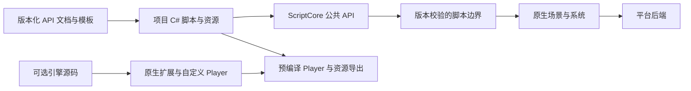

# 用二进制 HEngine 开发游戏

AI 不需要读取引擎 C++ 源码才能制作游戏。它需要版本一致的公共 API、支持范围、工作样例、资源格式工具和能观察结果的运行入口。这个 SDK 将这些内容作为产品的一部分发布。

## 开始工作

1. 读取安装根 `AGENTS.md`、`HEngine.distribution.json`、`HEngine.Runtime.json`，以及项目 `Project.heproject`、Config/Plugins.json、Config/BuildProfiles.json。
2. 执行 `hectl capabilities -Json`，据支持范围规划游戏。原生 Scene 和 PortableView 是不同宿主，不要把桌面 API 存在当成 Web/微信可用。
3. 选择 FirstPerson/TopDown/Scripted3D 或 SharedArena 模板，用 `hectl project create` 新建独立项目。先运行模板建立基线，再增量改动。
4. 阅读 [脚本指南](ScriptingGuide.md)、[系统覆盖表](ScriptingApiAudit-1.1.0.md)、`Docs/Api/index.md`；在 `api-index.json` 中按类型或成员查找，只读取相关页面。C# 查 XML/公开包装代码。不要扫描整个安装目录，也不要让 AI 猜测 Unity API 能否直接使用。
5. 内容编辑遵循 [场景编辑](SceneEditing.md)、[起始资源](StarterContent.md)、[输入](InputActions.md) 与 [发布](BuildAndPublish.md)。新增资源声明 cook 依赖。

## 每个功能的完成标准

对移动、碰撞、伤害、UI、音频、保存恢复和关卡流，每项都应包含脚本实现、实际资源/场景连接、可重复操作及可观察结果。先编译脚本；用已安装的 Development Player：`hectl agent start -Project <path> -BuildProfile windows`，发现命令后输入、步进、查询实体和 UI、查看日志/截图，finally 停止自己的会话。不要结束用户手动启动的 Editor。

最后从同一个项目导出 Shipping，验证资源闭包和启动。报告 edited/build/export/runtime 各自的结果。截图或普通启动不能证明碰撞、暂停或保存功能。设备不可用时记录 NOT RUN，不以桌面或模拟器结果代替手机。

## 发布给用户的内容

标准下载：预编译 Editor、Development Player、目标平台 Export Templates、脚本运行库、编译辅助工具、模板/示例、教程、C# API XML、机器可读索引与许可证。项目脚本编译所需的锁定 SDK/平台工具通过 `hectl deps check/install` 管理；“无需编译引擎”不等于“不需要脚本编译工具”。

源码包是独立可选下载，面向原生扩展、引擎调试、定制插件/平台；普通用户无需下载。二进制包可以包含公开脚本 SDK 的 C# 源文件，但不依赖完整 C++ 工程。第三方原生扩展必须与安装版和导出模板匹配，不能随意混用 DLL。

维护者在构建 SDK 时从当前编译产物重新生成 C# API 参考。二进制、文档、模板与运行库作为同一个版本发布；不要在旧 1.1.0 ZIP 里只替换文档就声称支持新增 API。
