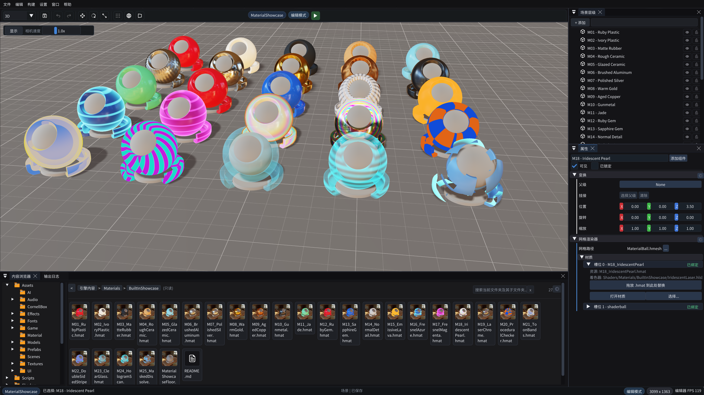

<p align="right"><a href="README.md">简体中文</a> · <strong>English</strong></p>

<p align="center">
  
</p>

<h1 align="center">HEngine</h1>

<p align="center">A modern C++20 game engine for Windows—from visual authoring to dual-backend rendering, physics, scripting, and shipping.</p>

<p align="center">
  <a href="RELEASE_NOTES.md"></a>
  
  
  
  <a href="LICENSE"></a>
</p>

<p align="center">
  <a href="#core-features">Core Features</a> ·
  <a href="#quick-start">Quick Start</a> ·
  <a href="#default-showcase">Showcase</a> ·
  <a href="#documentation">Documentation</a> ·
  <a href="RELEASE_NOTES.md">1.0.0 Release Notes</a>
</p>

<p align="center">
  
</p>

HEngine is an open-source game engine for Windows x64. It provides one integrated workflow spanning scene authoring, asset import, C++/Python gameplay, DX12/Vulkan rendering, Jolt 3D physics, and verified packaging.

**1.0.0** is the first official public release of HEngine. The repository includes a lightweight **HEngine Showcase** that opens `Physics3DTest.he` by default, demonstrating core engine capabilities without being tied to a complete game.

## Core Features

- **Visual editor**: Scene hierarchy, inspector, content browser, asset previews, and dedicated material, animation-controller, and runtime-UI tools.
- **Modern rendering architecture**: `RenderWorld -> SceneRenderer -> RenderGraph -> NVRHI`, with DirectX 12 and Vulkan 1.3 supported by the same runtime.
- **Materials and animation**: PBR materials, custom Surface Shaders, material hot reload, skeletal animation, and animation state machines.
- **3D physics**: Jolt Physics integration with rigid bodies, common collider shapes, character movement, ray/shape queries, and editor debug drawing.
- **Scripting and gameplay**: Native C++ Game modules, runtime Python scripts, reflection code generation, and serialization.
- **Asset and content pipeline**: Scene, Prefab, Mesh, Material, Texture, Audio, and UI resources, with glTF import and project-level content overrides.
- **UI, effects, and audio**: RmlUi, Effekseer, and the engine audio abstraction integrated with the runtime lifecycle.
- **Build and release workflow**: `hectl` provides isolated Game, Editor, test, capture, and Package flows; the Cooker validates dependency closure, manifests, hashes, and `Game.pak`.

## Quick Start

### Requirements

| Item | Requirement |
| --- | --- |
| Operating system | Windows 10 1909 (build 18363.1350+) or Windows 11 x64 |
| Compiler | Visual Studio 2022 with the v143 C++ toolchain |
| Language standard | C++20 |
| Build system | CMake 3.20 or newer |
| Additional dependency | Python 3 discoverable by CMake |

### Clone and validate

```powershell
git clone --recurse-submodules https://github.com/hebohang/HEngineDev.git
Set-Location HEngineDev
./hectl.bat doctor
./hectl.bat game check
```

`game check` configures and builds the development HGame, runs the default showcase scene, and exits automatically. The initial build time depends on the machine and local compiler cache.

### Common commands

| Command | Purpose |
| --- | --- |
| `./hectl.bat` | Build the default HGame development target |
| `./hectl.bat game check` | Build and perform a bounded Game runtime check |
| `./hectl.bat editor check` | Build and perform a bounded Editor runtime check |
| `./hectl.bat game open` | Launch Game interactively; the user closes the process |
| `./hectl.bat editor open` | Launch Editor interactively; the user closes the process |
| `./hectl.bat package` | Build, cook, and verify the Release game package |

Reflection code generation is part of the build graph and runs when needed before its consumers compile. Use `hectl codegen status|check|run` only when inspecting code generation independently.

## Default Showcase

The repository's `Project/` directory is the **HEngine Showcase**. Its default scene, [`Physics3DTest.he`](Project/Assets/Scenes/Physics3DTest.he), is a small project that can be run and edited immediately. It focuses on:

- 3D rigid bodies, colliders, friction, and restitution;
- Camera, environment, directional, and point lighting;
- Mesh, Material, Scene serialization, and resource loading;
- Companion Python, runtime UI, and custom Shader examples ready to extend.

You can modify this project directly or point `-Project` at a project outside the repository:

```powershell
./hectl.bat editor open -Project D:/Games/MyGame
```

See [Docs/Projects.md](Docs/Projects.md) for the multi-project layout and content-override rules.

## Support Matrix

| Capability | 1.0.0 status |
| --- | --- |
| Platform | Windows x64 |
| Graphics backends | DirectX 12 (default) and Vulkan 1.3 |
| Development builds | HGame, HEngineEditor, and headless logic/serialization tests |
| Release builds | `PACK_GAME=ON` cook, manifest, pak, and startup checks |
| Distribution | Source-first; no stable binary ABI is promised across compilers or releases |

Game and Editor include both DX12 and Vulkan backends in the same binary. Select one with `--graphics-api=dx12|vulkan`. Vulkan requires a graphics-driver loader that exposes Vulkan 1.3; see the [Windows graphics compatibility guide](Docs/WindowsGraphicsCompatibility.md) for capability baselines and fallback policy.

## Documentation

| Topic | Document |
| --- | --- |
| 1.0.0 contents and release boundary | [RELEASE_NOTES.md](RELEASE_NOTES.md) |
| Graphics backends and hardware capabilities | [Docs/WindowsGraphicsCompatibility.md](Docs/WindowsGraphicsCompatibility.md) |
| Multi-project and content boundaries | [Docs/Projects.md](Docs/Projects.md) |
| glTF / Mesh import | [Docs/AssetImporting.md](Docs/AssetImporting.md) |
| Shader-driven materials | [Docs/ShaderMaterials.md](Docs/ShaderMaterials.md) |
| Runtime UI motion | [Docs/RuntimeUiMotion.md](Docs/RuntimeUiMotion.md) |
| Rendering architecture | [Engine/Source/Runtime/Graphics/RenderingArchitecture.md](Engine/Source/Runtime/Graphics/RenderingArchitecture.md) |
| GM developer tools | [Docs/GM.md](Docs/GM.md) |

## Repository Layout

```text
Engine/   Engine source, built-in content, and tooling resources
Project/  Default HEngine Showcase project
Docs/     Feature and workflow documentation
Tools/    Build, validation, and content-processing tools
```

## Contributing

Issues and pull requests are welcome. Keep changes focused, avoid unrelated large-scale refactors, and run the smallest build or test that covers the change before submitting it. See [AGENTS.md](AGENTS.md) for repository development conventions.

## License and Acknowledgements

HEngine is available under the [MIT License](LICENSE). Third-party code and assets retain their respective licenses, which are distributed with the corresponding components or release package.

HEngine has been inspired and helped by these projects and learning resources: [Hazel](https://github.com/TheCherno/Hazel), [Pilot](https://github.com/BoomingTech/Pilot), [Godot](https://github.com/godotengine/godot), [LearnOpenGL](https://github.com/JoeyDeVries/LearnOpenGL), [LearningDirectX12](https://github.com/jpvanoosten/LearningDirectX12), [DirectX11-With-Windows-SDK](https://github.com/MKXJun/DirectX11-With-Windows-SDK), [Adria](https://github.com/mateeeeeee/Adria-DX12), [Vulkan Guide](https://github.com/vblanco20-1/vulkan-guide), [MoravaEngine](https://github.com/dtrajko/MoravaEngine), and [Ogre](https://github.com/OGRECave/ogre).
